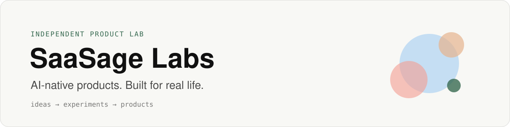
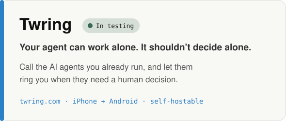
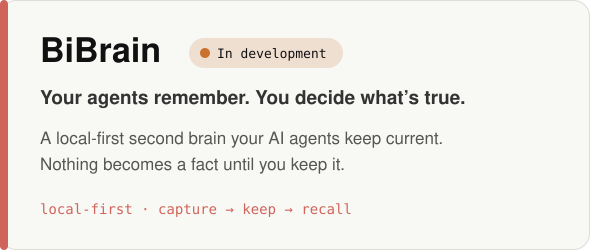

  

  <a href="https://saasage.in">saasage.in</a> &nbsp;·&nbsp;
  <a href="https://twring.com">twring.com</a> &nbsp;·&nbsp;
  <a href="https://x.com/rishflips">@rishflips on X</a>

SaaSage Labs is an independent product lab. We start with a real problem, build the smallest useful version, and test it in everyday life. AI is part of how we build, not a label added at the end.

## Products

<table>
  <tr>
    <td width="50%" valign="top">
      
    </td>
    <td width="50%" valign="top">
      
    </td>
  </tr>
</table>

**Twring** works with Hermes, Claude Code and Codex. It is in the Hermes plugin marketplace (`hermes plugins install twring`), and the code is open: [saasagelabs/twring](https://github.com/saasagelabs/twring).

## How we work

1. **Find the real problem.** Start from something that breaks in a normal day.
2. **Build with AI at the core.** Agents do real work; people make the decisions.
3. **Test, learn, keep building.** Ship small, say what works and what breaks.

## Talk to us

Built by Rish. Ideas, bugs or partnerships: open an issue on the product repo, or reach out through [saasage.in](https://saasage.in).

Independent. AI-native. Human-first.
